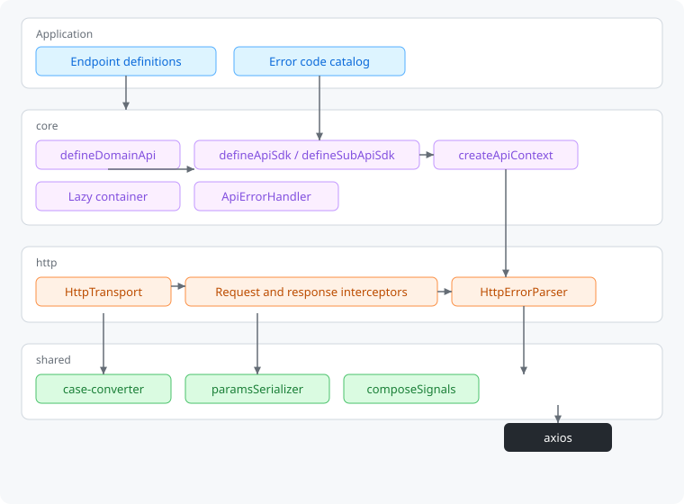
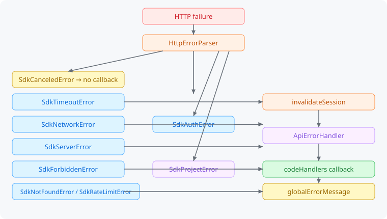
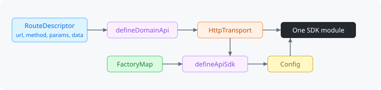

# frontend-api-core

HTTP client core for a frontend API SDK. The package provides an axios transport, a session, error parsing, and composition of domain modules. Concrete error codes and endpoints stay in the application.

`define*` describes a module: a set of endpoints or a map of factories. `createApiContext` builds a live client from config.

The only dependency is `axios`.

## Architecture



| Directory    | Role                                                           |
| ------------ | -------------------------------------------------------------- |
| `src/core`   | Config, context, module definitions, lazy container, errors    |
| `src/http`   | `HttpTransport`, interceptors, HTTP error parsing              |
| `src/shared` | Key conversion, query serialization, `AbortSignal` composition |

A call goes through a module method into `HttpTransport`. An interceptor prepares the body and the query, axios performs the request, and the response returns to the method. A failure goes to `HttpErrorParser`, then to `ApiErrorHandler`.

## Errors



`SdkTimeoutError` extends `SdkNetworkError`, so a timeout is checked before the generic network error. The handler skips `SdkCanceledError`. A `401` closes the session, then calls `onAuthError`.

The application passes the code catalog in the root config. The core only knows the shape: a name and a number. `codeHandlers` are selected by the `error` string in the response body. A code without its own callback falls through to `globalErrorMessage`.

```ts
const ErrorCodes = {
  UserNotFoundException: 1003,
} as const;

const api = createApiContext({
  baseUrl: '/api',
  errorCodes: ErrorCodes,
  errorConfig: {
    codeHandlers: {
      UserNotFoundException(error) {
        console.error(error.message);
      },
    },
    onAuthError() {
      window.location.assign('/login');
    },
    globalErrorMessage(message) {
      console.error(message);
    },
  },
});
```

The same `errorConfig` can be passed on a single request. `skipGlobalErrorHandler: true` disables the global `codeHandlers` and the shared message for that call.

Public classes: `SdkNetworkError`, `SdkTimeoutError`, `SdkServerError`, `SdkAuthError`, `SdkForbiddenError`, `SdkRateLimitError`, `SdkProjectError`.

## Endpoint module



`defineDomainApi` describes the endpoints of one domain and does not perform a request. `defineApiSdk` composes several domains into one module: a domain factory runs once, on the first access to its field. The second call, `defineApiSdk(factories)(config)`, creates the context and returns the module together with `resetSession` and `invalidateSession`.

`defineSubApiSdk` nests a group of endpoints in an existing context, without a second HTTP client.

```ts
import {
  createApiContext,
  defineApiSdk,
  defineDomainApi,
  defineSubApiSdk,
  type FactoryMap,
  type RouteDescriptor,
} from 'frontend-api-core';

interface ProfileResponse {
  id: string;
}

interface SettingsResponse {
  locale: string;
}

const profile = defineDomainApi((http) => ({
  getProfile: (): RouteDescriptor<ProfileResponse> => ({
    url: '/profile',
    method: 'GET',
  }),
}));

const settings = defineDomainApi((http) => ({
  getSettings: (): RouteDescriptor<SettingsResponse> => ({
    url: '/settings',
    method: 'GET',
  }),
}));

interface AccountSdk {
  profile: ReturnType<typeof profile>;
  settings: ReturnType<typeof settings>;
}

const account: FactoryMap<AccountSdk> = {
  profile: (ctx) => profile(ctx.http),
  settings: (ctx) => settings(ctx.http),
};

interface AppSdk {
  account: AccountSdk;
}

const sdk = defineApiSdk<AppSdk>({
  account: (ctx) => defineSubApiSdk(account)(ctx),
})({ baseUrl: '/api' });

await sdk.account.profile.getProfile();
await sdk.account.settings.getSettings();
```

The last argument of a method is an optional `SdkRequestConfig`. Pass it in the same call as the endpoint.

```ts
await sdk.account.profile.getProfile({ timeout: 5_000, signal: controller.signal });
```

Axios `paramsSerializer` can be configured for the whole client or overridden for one request. By default, the SDK serializes nested objects and arrays with bracket notation. Use the per-request option when an endpoint expects a different query format:

```ts
const api = createApiContext({
  baseUrl: '/api',
  paramsSerializer: {
    serialize: (params) => {
      const search = new URLSearchParams();
      Object.entries(params).forEach(([key, value]) => {
        if (Array.isArray(value)) value.forEach((item) => search.append(key, String(item)));
        else if (value !== null && value !== undefined) search.append(key, String(value));
      });
      return search.toString();
    },
  },
});

await api.http.get('/items', {
  params: { ids: [10, 20] },
});

// Per-request Axios serializer settings override the client defaults.
await api.http.get('/legacy/items', {
  params: { ids: [10, 20] },
  paramsSerializer: { indexes: null },
});
```

The serializer may be a function or an Axios `paramsSerializer` options object (`encode`, `serialize`, and `indexes`). Since it is part of `SdkRequestConfig`, it is available on raw `http` calls and as the optional final config argument on domain methods.

Domain methods return the response body. `http.getRaw()` returns the full Axios response when code needs status or headers; for binary requests, `responseType: 'blob'` returns the `Blob` body, and `getRaw()` can be used to retain its headers too.

A client without a module:

```ts
import { createApiContext } from 'frontend-api-core';

const api = createApiContext({
  baseUrl: '/api',
  getLocales: () => 'en',
});

await api.http.get<{ id: string }>('/profile');
const response = await api.http.getRaw<{ id: string }>({ url: '/profile' });
console.log(response.status, response.headers);
```

## Key case

Keys are left unchanged by default. `convertCase: true` converts request keys to `snake_case`, and response and error-body keys to `camelCase`.

```ts
createApiContext({
  baseUrl: '/api',
  convertCase: true,
});
```

The response type follows the flag. `createApiContext({ convertCase: true })` returns a client whose methods yield the camelCase form of the body.

## Session

`HttpTransport` holds a shared `AbortController`. `invalidateSession()` aborts in-flight requests and blocks new ones. `resetSession()` opens a new session. Both methods are on the result of `defineApiSdk`. A request with `skipAuthAbort: true` is not tied to the session.

## Commits and publishing

Commit messages follow [Conventional Commits](https://www.conventionalcommits.org/en/v1.0.0/) and determine the [SemVer](https://semver.org/spec/v2.0.0.html) version. On a pull request, commitlint checks the whole range and a changelog comment is posted from those commits. After a merge into `master`, semantic-release updates `CHANGELOG.md`, creates a tag, and publishes the package to npm.

Rules, examples, and CI secrets: [docs/commits.md](docs/commits.md).

## License

[MIT](LICENSE)
